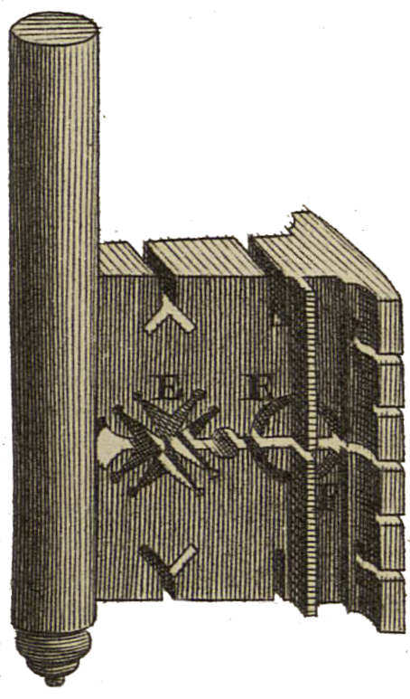

<div align="center" id="head">


<table>
<tr>
<td></td>
<td align="left">
<h1 style="margin:0">Scantailor PDF+</h1>
<p style="margin:0.25em 0 0"><strong>Scan-Nachbearbeitung · natives PDF</strong><br/>PDF-Import / -Export · Fork von ScanTailor-Experimental</p>
</td>
</tr>
</table>

<a href="https://atelier.atechnologie.fr/" title="l'Atelier – Verein für Buchherstellung und Forschungswerkzeuge"></a>  
<sub>Entwickelt von <a href="https://atelier.atechnologie.fr/">l'Atelier</a> — Buchherstellung und Forschungswerkzeuge (EHESS)</sub>

<p>
🇫🇷 <a href="README.md">Français</a> ·
🇬🇧 <a href="README.en.md">English</a> ·
🇩🇪 <a href="README.de.md"><b>Deutsch</b></a> ·
🇪🇸 <a href="README.es.md">Español</a>
</p>

<p>
<a href="https://atelier.atechnologie.fr/"></a>
<a href="https://github.com/Atelier-Recherche/scantailor-pdf-plus"></a>
</p>

</div>

---

## 📸 Vorschau

| Oberfläche | Verarbeitung |
| :---: | :---: |
|  |  |

---
## 📖 Über

**Scantailor PDF+** ist ein Derivat von [ScanTailor-Experimental](https://github.com/ImageProcessing-ElectronicPublications/scantailor-experimental) mit nativem **PDF-Import** und **PDF-Export**.

---

## ✨ Neu in PDF+

Gegenüber ScanTailor-Experimental ergänzt dieser Fork:

- **PDF-Import** — mehrseitige PDF-Dateien als Projekteingabe öffnen (Qt6 Pdf)
- **PDF-Export** — verarbeitete Seiten nach der Stapelverarbeitung zu einem PDF zusammensetzen
- CMake-Optionen `ENABLE_PDF_INPUT` / `ENABLE_PDF_EXPORT` (standardmäßig aktiv bei Qt6-Build)

Alles Weitere bleibt der interaktive Scan-Tailor-Arbeitsablauf: Seitentrennung, Entzerrung, Ränder, Inhaltsauswahl usw.

---

## 🙏 Credits & Danksagungen

Dieses Projekt gäbe es ohne die Arbeit vieler Menschen nicht. **Danke.**

| Projekt / Personen | Beitrag |
| --- | --- |
| [Joseph Artsimovich](https://github.com/Tulon) | Originales [Scan Tailor](https://web.archive.org/web/20210304010738/http://scantailor.org/) |
| [Nate Craun](https://natecraun.net/) ([@ncraun](https://github.com/ncraun)) | Maintainer ab 2014 |
| [ImageProcessing-ElectronicPublications](https://github.com/ImageProcessing-ElectronicPublications) und Mitwirkende | [ScanTailor-Experimental](https://github.com/ImageProcessing-ElectronicPublications/scantailor-experimental) (seit 2023) |

ScanTailor PDF+ folgt dem Upstream ScanTailor-Experimental und legt PDF-Funktionen darüber. Bitte melden Sie Bugs, die **nicht** PDF-bezogen sind, bevorzugt in den [Upstream-Issues](https://github.com/ImageProcessing-ElectronicPublications/scantailor-experimental/issues), sofern zutreffend.

Upstream-Repository: https://github.com/ImageProcessing-ElectronicPublications/scantailor-experimental

---

## 📚 Über Scan Tailor

ScanTailor ist ein interaktives Nachbearbeitungswerkzeug für gescannte Seiten. Es führt unter anderem aus:

- [Seitentrennung](https://github.com/ImageProcessing-ElectronicPublications/scantailor-experimental/wiki/Split-Pages)
- [Entzerrung](https://github.com/ImageProcessing-ElectronicPublications/scantailor-experimental/wiki/Deskew)
- [Ränder hinzufügen/entfernen](https://github.com/ImageProcessing-ElectronicPublications/scantailor-experimental/wiki/Page-Layout)
- [Inhaltsauswahl](https://github.com/ImageProcessing-ElectronicPublications/scantailor-experimental/wiki/Select-Content)
- … und weiteres

Sie geben Rohscans (oder PDFs in diesem Fork) hinein und erhalten Seiten, die gedruckt oder zu PDF bzw. [DJVU](http://elpa.gnu.org/packages/djvu.html) zusammengesetzt werden können. Scannen und OCR bleiben außerhalb des Umfangs.

ScanTailor ist [Freie Software](https://www.gnu.org/philosophy/free-sw.html), geschrieben in C++ mit Qt, unter der **GNU General Public License version 3**.

---

## 📜 Geschichte

Das Projekt begann Ende 2007 und erreichte Mitte 2010 Produktionsqualität.

2014 trat der ursprüngliche Entwickler [Joseph Artsimovich](https://github.com/Tulon) zurück, und [Nate Craun](https://natecraun.net/) ([@ncraun](https://github.com/ncraun)) übernahm die [Wartung](https://web.archive.org/web/20140428040025/scantailor.org/2014/04/06/new-maintainer.html).

2023 begann der Fork ScanTailor-Experimental ein Eigenleben.

**ScanTailor PDF+** setzt diese Linie fort, mit PDF-Import/Export als Schwerpunkt dieses Derivats.

---

## 🔄 Mit dem Upstream synchron bleiben

Dieses Repository verwendet:

- `origin` → diesen PDF+-Fork
- `upstream` → [scantailor-experimental](https://github.com/ImageProcessing-ElectronicPublications/scantailor-experimental)

Empfohlener Ablauf:

```bash
git fetch upstream
git checkout main
git merge upstream/main
# Konflikte ggf. lösen, dann Ihren PDF-Feature-Branch aktualisieren
```

---

## ⬇️ Installation und Tipps

Siehe das Upstream-Wiki zur allgemeinen Nutzung:

- [Scanning Tips](https://github.com/ImageProcessing-ElectronicPublications/scantailor-experimental/wiki/Tips-for-Scanning)
- [Quick-Start Guide](https://github.com/ImageProcessing-ElectronicPublications/scantailor-experimental/wiki/Quick-Start-Guide)
- [Usage Guide](https://github.com/ImageProcessing-ElectronicPublications/scantailor-experimental/wiki/User-Guide)
- [Building from source](https://github.com/ImageProcessing-ElectronicPublications/scantailor-experimental/wiki/Building-from-Source-Code-on-Linux-and-Mac-OS-X)

PDF-Eingabe erfordert einen **Qt6**-Build mit dem Qt-Pdf-Modul.

Upstream-Windows-Installation (ohne PDF+-Funktionen):

```cmd
winget install "IPEP.Scantailor-Experimental"
```

---

## 🔗 Weitere Links

- [Linux Guide to Book Scanning](https://natecraun.net/articles/linux-guide-to-book-scanning.html)
- [DIY Book Scanner Forum](http://diybookscanner.org/forum/)
- [Scan Tailor Subforum](http://diybookscanner.org/forum/viewforum.php?f=21)
- 🌐 [l’Atelier](https://atelier.atechnologie.fr/)
- 📦 [GitHub-Repository](https://github.com/Atelier-Recherche/scantailor-pdf-plus)
