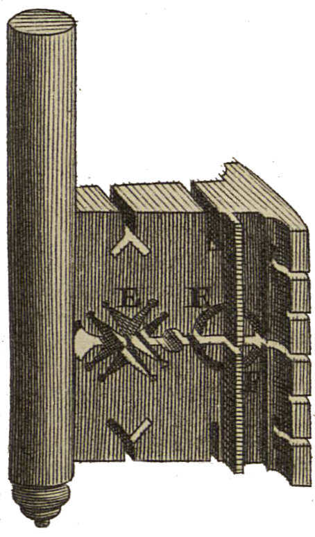

<div align="center" id="head">


<table>
<tr>
<td></td>
<td align="left">
<h1 style="margin:0">Scantailor PDF+</h1>
<p style="margin:0.25em 0 0"><strong>Scan post-processing · native PDF</strong><br/>PDF import / export · ScanTailor-Experimental fork</p>
</td>
</tr>
</table>

<a href="https://atelier.atechnologie.fr/" title="l'Atelier – book-making and research tools association"></a>  
<sub>Developed by <a href="https://atelier.atechnologie.fr/">l'Atelier</a> — book-making and research tools (EHESS)</sub>

<p>
🇫🇷 <a href="README.md">Français</a> ·
🇬🇧 <a href="README.en.md"><b>English</b></a> ·
🇩🇪 <a href="README.de.md">Deutsch</a> ·
🇪🇸 <a href="README.es.md">Español</a>
</p>

<p>
<a href="https://atelier.atechnologie.fr/"></a>
<a href="https://github.com/Atelier-Recherche/scantailor-pdf-plus"></a>
</p>

</div>

---

## 📸 Preview

| Interface | Processing |
| :---: | :---: |
|  |  |

---
## 📖 About

**Scantailor PDF+** is a derivative of [ScanTailor-Experimental](https://github.com/ImageProcessing-ElectronicPublications/scantailor-experimental) with native **PDF import** and **PDF export**.

---

## ✨ What's new in PDF+

On top of ScanTailor-Experimental, this fork adds:

- **PDF import** — open multi-page PDF files as project input (Qt6 Pdf)
- **PDF export** — assemble processed pages into a PDF after batch processing
- CMake options `ENABLE_PDF_INPUT` / `ENABLE_PDF_EXPORT` (enabled by default when building with Qt6)

Everything else remains the Scan Tailor interactive workflow: page splitting, deskewing, borders, content selection, and more.

---

## 🙏 Credits & acknowledgements

This project would not exist without the work of many people. **Thank you.**

| Project / people | Contribution |
| --- | --- |
| [Joseph Artsimovich](https://github.com/Tulon) | Original [Scan Tailor](https://web.archive.org/web/20210304010738/http://scantailor.org/) |
| [Nate Craun](https://natecraun.net/) ([@ncraun](https://github.com/ncraun)) | Maintainer after 2014 |
| [ImageProcessing-ElectronicPublications](https://github.com/ImageProcessing-ElectronicPublications) and contributors | [ScanTailor-Experimental](https://github.com/ImageProcessing-ElectronicPublications/scantailor-experimental) (from 2023) |

ScanTailor PDF+ tracks upstream ScanTailor-Experimental and layers PDF features on top. Please prefer reporting bugs that are **not** PDF-related against the [upstream Issues](https://github.com/ImageProcessing-ElectronicPublications/scantailor-experimental/issues) when applicable.

Upstream repository: https://github.com/ImageProcessing-ElectronicPublications/scantailor-experimental

---

## 📚 About Scan Tailor

ScanTailor is an interactive post-processing tool for scanned pages. It performs operations such as:

- [page splitting](https://github.com/ImageProcessing-ElectronicPublications/scantailor-experimental/wiki/Split-Pages)
- [deskewing](https://github.com/ImageProcessing-ElectronicPublications/scantailor-experimental/wiki/Deskew)
- [adding/removing borders](https://github.com/ImageProcessing-ElectronicPublications/scantailor-experimental/wiki/Page-Layout)
- [selecting content](https://github.com/ImageProcessing-ElectronicPublications/scantailor-experimental/wiki/Select-Content)
- … and others

You give it raw scans (or PDFs in this fork), and you get pages ready to be printed or assembled into a PDF or [DJVU](http://elpa.gnu.org/packages/djvu.html) file. Scanning and OCR remain out of scope.

ScanTailor is [Free Software](https://www.gnu.org/philosophy/free-sw.html), written in C++ with Qt, released under the **GNU General Public License version 3**.

---

## 📜 History

This project started in late 2007 and by mid 2010 it reached production quality.

In 2014, the original developer [Joseph Artsimovich](https://github.com/Tulon) stepped aside, and [Nate Craun](https://natecraun.net/) ([@ncraun](https://github.com/ncraun)) took over as the [new maintainer](https://web.archive.org/web/20140428040025/scantailor.org/2014/04/06/new-maintainer.html).

In 2023 the ScanTailor-Experimental fork began its own life.

**ScanTailor PDF+** continues from that lineage with PDF import/export as the main focus of this derivative.

---

## 🔄 Keeping in sync with upstream

This repository uses:

- `origin` → this PDF+ fork
- `upstream` → [scantailor-experimental](https://github.com/ImageProcessing-ElectronicPublications/scantailor-experimental)

Suggested workflow:

```bash
git fetch upstream
git checkout main
git merge upstream/main
# resolve conflicts if any, then update your PDF feature branch
```

---

## ⬇️ Installation and tips

See the upstream wiki for general usage:

- [Scanning Tips](https://github.com/ImageProcessing-ElectronicPublications/scantailor-experimental/wiki/Tips-for-Scanning)
- [Quick-Start Guide](https://github.com/ImageProcessing-ElectronicPublications/scantailor-experimental/wiki/Quick-Start-Guide)
- [Usage Guide](https://github.com/ImageProcessing-ElectronicPublications/scantailor-experimental/wiki/User-Guide)
- [Building from source](https://github.com/ImageProcessing-ElectronicPublications/scantailor-experimental/wiki/Building-from-Source-Code-on-Linux-and-Mac-OS-X)

PDF input requires a **Qt6** build with the Qt Pdf module.

Upstream Windows install (without PDF+ features):

```cmd
winget install "IPEP.Scantailor-Experimental"
```

---

## 🔗 Additional links

- [Linux Guide to Book Scanning](https://natecraun.net/articles/linux-guide-to-book-scanning.html)
- [DIY Book Scanner Forum](http://diybookscanner.org/forum/)
- [Scan Tailor Subforum](http://diybookscanner.org/forum/viewforum.php?f=21)
- 🌐 [l’Atelier](https://atelier.atechnologie.fr/)
- 📦 [GitHub repository](https://github.com/Atelier-Recherche/scantailor-pdf-plus)
