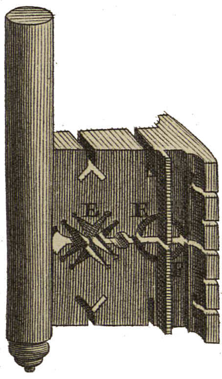

<div align="center" id="head">


<table>
<tr>
<td></td>
<td align="left">
<h1 style="margin:0">Scantailor PDF+</h1>
<p style="margin:0.25em 0 0"><strong>Postprocesado de escaneos · PDF nativo</strong><br/>Importación / exportación PDF · fork de ScanTailor-Experimental</p>
</td>
</tr>
</table>

<a href="https://atelier.atechnologie.fr/" title="l'Atelier – asociación de fabricación de libros y herramientas de investigación"></a>  
<sub>Desarrollado por <a href="https://atelier.atechnologie.fr/">l'Atelier</a> — fabricación de libros y herramientas de investigación (EHESS)</sub>

<p>
🇫🇷 <a href="README.md">Français</a> ·
🇬🇧 <a href="README.en.md">English</a> ·
🇩🇪 <a href="README.de.md">Deutsch</a> ·
🇪🇸 <a href="README.es.md"><b>Español</b></a>
</p>

<p>
<a href="https://atelier.atechnologie.fr/"></a>
<a href="https://github.com/Atelier-Recherche/scantailor-pdf-plus"></a>
</p>

</div>

---

## 📸 Vista previa

| Interfaz | Procesado |
| :---: | :---: |
|  |  |

---
## 📖 Acerca de

**Scantailor PDF+** es un derivado de [ScanTailor-Experimental](https://github.com/ImageProcessing-ElectronicPublications/scantailor-experimental) con **importación PDF** y **exportación PDF** nativas.

---

## ✨ Novedades PDF+

Sobre ScanTailor-Experimental, este fork añade:

- **Importación PDF** — abrir PDF multipágina como entrada de proyecto (Qt6 Pdf)
- **Exportación PDF** — ensamblar las páginas procesadas en un PDF tras el procesamiento por lotes
- Opciones CMake `ENABLE_PDF_INPUT` / `ENABLE_PDF_EXPORT` (activadas por defecto al compilar con Qt6)

Todo lo demás conserva el flujo interactivo de Scan Tailor: división de páginas, enderezado, bordes, selección de contenido, etc.

---

## 🙏 Créditos y agradecimientos

Este proyecto no existiría sin el trabajo de muchas personas. **Gracias.**

| Proyecto / personas | Contribución |
| --- | --- |
| [Joseph Artsimovich](https://github.com/Tulon) | [Scan Tailor](https://web.archive.org/web/20210304010738/http://scantailor.org/) original |
| [Nate Craun](https://natecraun.net/) ([@ncraun](https://github.com/ncraun)) | Mantenedor tras 2014 |
| [ImageProcessing-ElectronicPublications](https://github.com/ImageProcessing-ElectronicPublications) y colaboradores | [ScanTailor-Experimental](https://github.com/ImageProcessing-ElectronicPublications/scantailor-experimental) (desde 2023) |

Scantailor PDF+ sigue el upstream ScanTailor-Experimental y añade las funciones PDF encima. Preferid reportar bugs **no relacionados con PDF** en los [Issues upstream](https://github.com/ImageProcessing-ElectronicPublications/scantailor-experimental/issues) cuando proceda.

Repositorio upstream: https://github.com/ImageProcessing-ElectronicPublications/scantailor-experimental

---

## 📚 Acerca de Scan Tailor

ScanTailor es una herramienta interactiva de postprocesado para páginas escaneadas. Realiza operaciones como:

- [división de páginas](https://github.com/ImageProcessing-ElectronicPublications/scantailor-experimental/wiki/Split-Pages)
- [enderezado](https://github.com/ImageProcessing-ElectronicPublications/scantailor-experimental/wiki/Deskew)
- [añadir/quitar bordes](https://github.com/ImageProcessing-ElectronicPublications/scantailor-experimental/wiki/Page-Layout)
- [selección de contenido](https://github.com/ImageProcessing-ElectronicPublications/scantailor-experimental/wiki/Select-Content)
- … y otras

Le das escaneos en bruto (o PDF en este fork) y obtienes páginas listas para imprimir o ensamblar en PDF o [DJVU](http://elpa.gnu.org/packages/djvu.html). El escaneo y el OCR quedan fuera del alcance.

ScanTailor es [software libre](https://www.gnu.org/philosophy/free-sw.html), escrito en C++ con Qt, bajo la **GNU General Public License version 3**.

---

## 📜 Historia

El proyecto empezó a finales de 2007 y hacia mediados de 2010 alcanzó calidad de producción.

En 2014, el desarrollador original [Joseph Artsimovich](https://github.com/Tulon) se retiró, y [Nate Craun](https://natecraun.net/) ([@ncraun](https://github.com/ncraun)) asumió el [mantenimiento](https://web.archive.org/web/20140428040025/scantailor.org/2014/04/06/new-maintainer.html).

En 2023 el fork ScanTailor-Experimental inició su propia vida.

**Scantailor PDF+** continúa esa línea con la importación/exportación PDF como foco principal de este derivado.

---

## 🔄 Mantenerse sincronizado con el upstream

Este repositorio usa:

- `origin` → este fork PDF+
- `upstream` → [scantailor-experimental](https://github.com/ImageProcessing-ElectronicPublications/scantailor-experimental)

Flujo sugerido:

```bash
git fetch upstream
git checkout main
git merge upstream/main
# resolver conflictos si los hay, luego actualizar tu rama de funciones PDF
```

---

## ⬇️ Instalación y consejos

Consulta el wiki upstream para el uso general:

- [Scanning Tips](https://github.com/ImageProcessing-ElectronicPublications/scantailor-experimental/wiki/Tips-for-Scanning)
- [Quick-Start Guide](https://github.com/ImageProcessing-ElectronicPublications/scantailor-experimental/wiki/Quick-Start-Guide)
- [Usage Guide](https://github.com/ImageProcessing-ElectronicPublications/scantailor-experimental/wiki/User-Guide)
- [Building from source](https://github.com/ImageProcessing-ElectronicPublications/scantailor-experimental/wiki/Building-from-Source-Code-on-Linux-and-Mac-OS-X)

La entrada PDF requiere un build **Qt6** con el módulo Qt Pdf.

Instalación Windows upstream (sin funciones PDF+):

```cmd
winget install "IPEP.Scantailor-Experimental"
```

---

## 🔗 Enlaces adicionales

- [Linux Guide to Book Scanning](https://natecraun.net/articles/linux-guide-to-book-scanning.html)
- [DIY Book Scanner Forum](http://diybookscanner.org/forum/)
- [Scan Tailor Subforum](http://diybookscanner.org/forum/viewforum.php?f=21)
- 🌐 [l’Atelier](https://atelier.atechnologie.fr/)
- 📦 [Repositorio GitHub](https://github.com/Atelier-Recherche/scantailor-pdf-plus)
