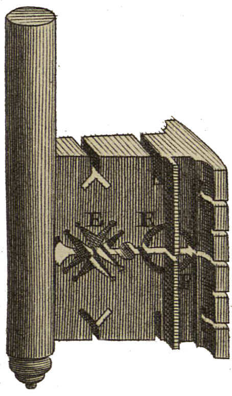

<div align="center" id="head">


<table>
<tr>
<td></td>
<td align="left">
<h1 style="margin:0">Scantailor PDF+</h1>
<p style="margin:0.25em 0 0"><strong>Post-traitement de scans · PDF natif</strong><br/>Import / export PDF · fork ScanTailor-Experimental</p>
</td>
</tr>
</table>

<a href="https://atelier.atechnologie.fr/" title="l'Atelier – Association de fabrication de livres et d'outils de recherche"></a>  
<sub>Développé par <a href="https://atelier.atechnologie.fr/">l'Atelier</a> — fabrication de livres et outils de recherche (EHESS)</sub>

<p>
🇫🇷 <a href="README.md"><b>Français</b></a> ·
🇬🇧 <a href="README.en.md">English</a> ·
🇩🇪 <a href="README.de.md">Deutsch</a> ·
🇪🇸 <a href="README.es.md">Español</a>
</p>

<p>
<a href="https://atelier.atechnologie.fr/"></a>
<a href="https://github.com/Atelier-Recherche/scantailor-pdf-plus"></a>
</p>

</div>

---

## 📸 Aperçu

| Interface | Traitement |
| :---: | :---: |
|  |  |

---
## 📖 À propos

**Scantailor PDF+** est un dérivé de [ScanTailor-Experimental](https://github.com/ImageProcessing-ElectronicPublications/scantailor-experimental) avec **import PDF** et **export PDF** natifs.

---

## ✨ Nouveautés PDF+

Par rapport à ScanTailor-Experimental, ce fork ajoute :

- **Import PDF** — ouvrir des PDF multipages comme entrée de projet (Qt6 Pdf)
- **Export PDF** — assembler les pages traitées en PDF après le traitement par lot
- Options CMake `ENABLE_PDF_INPUT` / `ENABLE_PDF_EXPORT` (activées par défaut lors d’un build Qt6)

Le reste conserve le flux interactif Scan Tailor : découpage de pages, redressement, bordures, sélection de contenu, etc.

---

## 🙏 Crédits & remerciements

Ce projet n’existerait pas sans le travail de nombreuses personnes. **Merci.**

| Projet / personnes | Contribution |
| --- | --- |
| [Joseph Artsimovich](https://github.com/Tulon) | [Scan Tailor](https://web.archive.org/web/20210304010738/http://scantailor.org/) original |
| [Nate Craun](https://natecraun.net/) ([@ncraun](https://github.com/ncraun)) | Mainteneur après 2014 |
| [ImageProcessing-ElectronicPublications](https://github.com/ImageProcessing-ElectronicPublications) et contributeurs | [ScanTailor-Experimental](https://github.com/ImageProcessing-ElectronicPublications/scantailor-experimental) (depuis 2023) |

Scantailor PDF+ suit l’amont ScanTailor-Experimental et ajoute les fonctions PDF par-dessus. Merci de signaler de préférence les bugs **non liés au PDF** dans les [Issues amont](https://github.com/ImageProcessing-ElectronicPublications/scantailor-experimental/issues) lorsque c’est pertinent.

Dépôt amont : https://github.com/ImageProcessing-ElectronicPublications/scantailor-experimental

---

## 📚 À propos de Scan Tailor

ScanTailor est un outil interactif de post-traitement pour pages scannées. Il réalise notamment :

- [découpage de pages](https://github.com/ImageProcessing-ElectronicPublications/scantailor-experimental/wiki/Split-Pages)
- [redressement](https://github.com/ImageProcessing-ElectronicPublications/scantailor-experimental/wiki/Deskew)
- [ajout / suppression de bordures](https://github.com/ImageProcessing-ElectronicPublications/scantailor-experimental/wiki/Page-Layout)
- [sélection de contenu](https://github.com/ImageProcessing-ElectronicPublications/scantailor-experimental/wiki/Select-Content)
- … et d’autres

Vous lui donnez des scans bruts (ou des PDF dans ce fork), et vous obtenez des pages prêtes à imprimer ou à assembler en PDF ou [DJVU](http://elpa.gnu.org/packages/djvu.html). La numérisation et l’OCR restent hors périmètre.

ScanTailor est un [logiciel libre](https://www.gnu.org/philosophy/free-sw.html), écrit en C++ avec Qt, sous **GNU General Public License version 3**.

---

## 📜 Historique

Le projet a démarré fin 2007 et a atteint une qualité de production vers mi-2010.

En 2014, le développeur d’origine [Joseph Artsimovich](https://github.com/Tulon) s’est retiré, et [Nate Craun](https://natecraun.net/) ([@ncraun](https://github.com/ncraun)) a repris la [maintenance](https://web.archive.org/web/20140428040025/scantailor.org/2014/04/06/new-maintainer.html).

En 2023, le fork ScanTailor-Experimental a pris son autonomie.

**Scantailor PDF+** poursuit cette lignée avec l’import/export PDF comme focus principal de ce dérivé.

---

## 🔄 Rester synchronisé avec l’amont

Ce dépôt utilise :

- `origin` → ce fork PDF+
- `upstream` → [scantailor-experimental](https://github.com/ImageProcessing-ElectronicPublications/scantailor-experimental)

Flux suggéré :

```bash
git fetch upstream
git checkout main
git merge upstream/main
# résoudre les conflits le cas échéant, puis mettre à jour votre branche de fonctionnalités PDF
```

---

## ⬇️ Installation et conseils

Voir le wiki amont pour l’usage général :

- [Scanning Tips](https://github.com/ImageProcessing-ElectronicPublications/scantailor-experimental/wiki/Tips-for-Scanning)
- [Quick-Start Guide](https://github.com/ImageProcessing-ElectronicPublications/scantailor-experimental/wiki/Quick-Start-Guide)
- [Usage Guide](https://github.com/ImageProcessing-ElectronicPublications/scantailor-experimental/wiki/User-Guide)
- [Building from source](https://github.com/ImageProcessing-ElectronicPublications/scantailor-experimental/wiki/Building-from-Source-Code-on-Linux-and-Mac-OS-X)

L’entrée PDF nécessite un build **Qt6** avec le module Qt Pdf.

Install Windows amont (sans les fonctions PDF+) :

```cmd
winget install "IPEP.Scantailor-Experimental"
```

---

## 🔗 Liens supplémentaires

- [Linux Guide to Book Scanning](https://natecraun.net/articles/linux-guide-to-book-scanning.html)
- [DIY Book Scanner Forum](http://diybookscanner.org/forum/)
- [Scan Tailor Subforum](http://diybookscanner.org/forum/viewforum.php?f=21)
- 🌐 [l’Atelier](https://atelier.atechnologie.fr/)
- 📦 [Dépôt GitHub](https://github.com/Atelier-Recherche/scantailor-pdf-plus)
